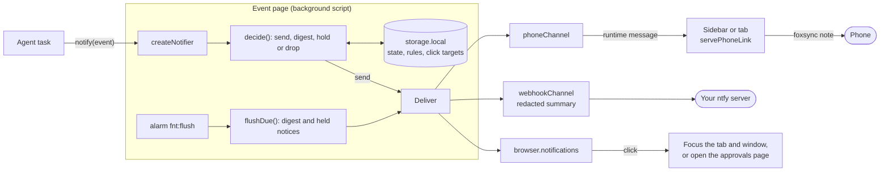
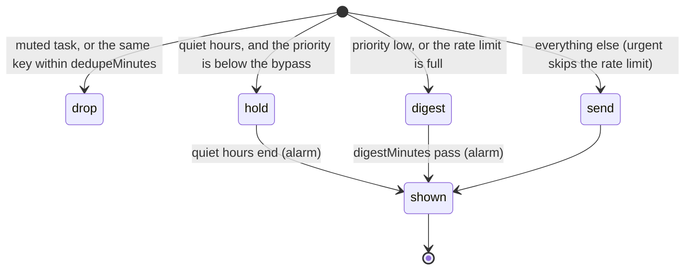
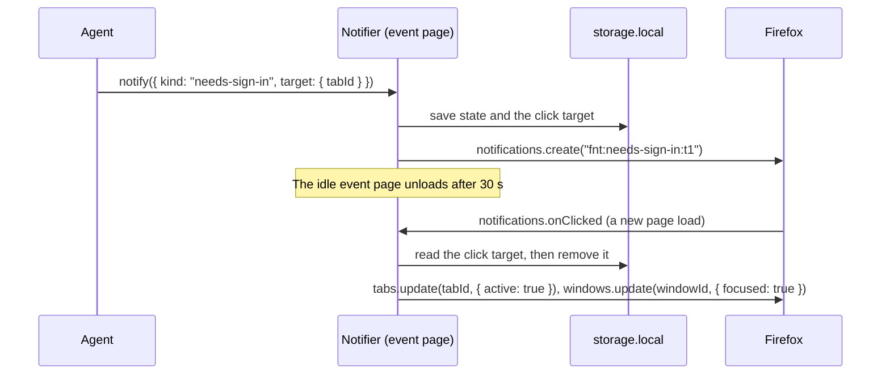
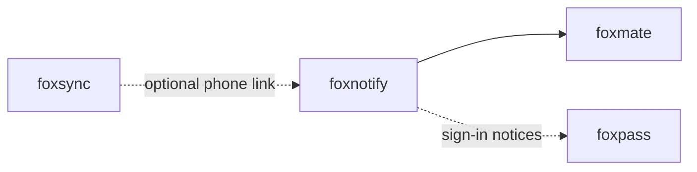

# foxnotify

Tell the user when a Firefox agent task needs them, on desktop and phone, with quiet hours.

An agent that runs in your browser stops when it needs you: to approve an
action, to sign in, or because it is stuck. foxnotify turns those moments into
notices. It decides what to show now, what to hold for quiet hours, and what
to put in a digest. A click on a desktop notice takes you to the right tab or
page. A notice can also go to your phone, through a webhook (for example your
own ntfy server) or through the [foxsync](https://github.com/pooriaarab/foxsync)
encrypted link.

foxnotify is a library. It has no CLI and no MCP server. The repo also has a
demo extension with a fake agent and a settings page.

## Install

```bash
npm i foxnotify
```

foxnotify needs Firefox 153 or later. The rules part also runs in Node 24 or
later.

## Example

The rules are plain functions, so this runs in Node as written:

```js
import { decide, emptyState, parseRules } from "foxnotify";

const rules = parseRules({ quietHours: { start: "22:00", end: "07:00" } });
const night = new Date(2026, 9, 9, 23, 30).getTime();

const done = decide(emptyState(), { kind: "task-done", taskId: "t1", title: "Book a table" }, rules, night);
console.log(done.decision); // { action: 'hold', reason: 'quiet-hours' }

const ask = { kind: "needs-approval", taskId: "t1", title: "Send the form", priority: "urgent" };
const urgent = decide(done.state, ask, rules, night);
console.log(urgent.decision); // { action: 'send' }
```

In an extension, `createNotifier` runs the same rules in the background
script. It saves its state in `storage.local` and shows the notices:

```js
import { createNotifier, webhookChannel } from "foxnotify";

// Call this in the first turn of the background script, so the click and
// alarm listeners exist on every wake.
const notifier = createNotifier({
  browser,
  storage: browser.storage.local,
  rules: { quietHours: { start: "22:00", end: "07:00" } },
  channels: [webhookChannel({ url: "https://ntfy.example.org/my-agent" })],
  fallbackUrl: "approvals.html",
});

notifier.notify({
  kind: "needs-approval",
  taskId: "t42",
  title: "Pay the electricity bill",
  target: { url: browser.runtime.getURL("approvals.html#t42") },
});
```

The manifest needs the `notifications`, `alarms` and `storage` permissions.

## Use cases

| Who | What they build | How foxnotify helps |
|---|---|---|
| A developer of a browser agent such as [foxmate](https://github.com/pooriaarab/foxmate) | An agent that asks before it sends a form | `needs-approval` shows a notice. A click opens the page with Approve and Deny, so the notice never approves anything. |
| A user who leaves long tasks running | A morning summary instead of ten pop-ups | Low-priority notices, such as "task done", go into one digest. Quiet hours hold the rest until morning. |
| A developer of a password or login helper such as [foxpass](https://github.com/pooriaarab/foxpass) | A pause that waits for the user to sign in | `needs-sign-in` shows a notice. A click makes the task tab active and focuses its window. |
| A home-lab owner with a Firefox that runs scheduled jobs | Alerts on the phone when a job fails or misses its time | `task-stuck` and `schedule-missed` go to a self-hosted ntfy topic. By default the webhook gets no task title. |
| An extension author with any background work | Rate-limited, de-duplicated notices | A loop that reports the same failure 50 times shows one notice. Other events over the rate limit go to the digest. |
| A QA engineer | A test run that waits for a person | The test emits `needs-approval` with priority `urgent`, so it comes through quiet hours. |
| A family member who helps a parent with an agent | Approval requests on their own phone | The foxsync link carries the notice, encrypted, to the paired phone. |

## How it works



Each event gets one of four decisions:



A click on a notice, also after Firefox unloads the event page:



Details:

- **Priorities.** `low`, `normal`, `high` and `urgent`. The defaults per kind
  are: `needs-approval` and `needs-sign-in` high, `task-stuck` normal,
  `task-done` and `schedule-missed` low. The event or `rules.priorities`
  can change them.
- **Quiet hours.** Local time, "HH:MM", and they can cross midnight. A notice
  below `bypass` (default `urgent`) waits. When quiet hours end, one alarm
  shows the held notices together. The same start and end means no quiet
  hours.
- **Digest.** Low-priority notices wait `digestMinutes` (default 60). Then
  they show as one notice, such as "3 updates from your agent". A digest of
  one notice shows as that notice, with its own click target.
- **Repeats and floods.** A second event with the same key (default
  `<kind>:<taskId>`) within `dedupeMinutes` (default 10) is dropped. More
  than `rateLimit.max` notices per `rateLimit.perMinutes` (default 4 per 1)
  go to the digest, not away. The queue keeps the newest 50 notices and
  counts the rest in the digest.
- **Text.** The notice text is a fixed sentence for each kind plus the task
  title. Nothing else from the event reaches the text. `cleanTitle` makes the
  title one line of at most 80 characters. It replaces codes of 6 or more
  digits, card numbers, email addresses and long tokens with `[hidden]`, and
  keeps only the host of a URL.
- **Webhook.** By default the body holds the kind, the priority, a fixed
  sentence and the time. The task title goes in only with `includeTitle`.
  `previewWebhook` builds the same request, so a settings page can show it
  before the user turns the webhook on.
- **Phone link.** A WebRTC link dies when the event page unloads, so the link
  lives in a page that stays open, such as the sidebar. `phoneChannel` hands
  the notice to that page, and `servePhoneLink` sends it to the phone as a
  foxsync `note`. The phone link gets the same text as the desktop, title
  included, because the link is encrypted to your own paired phone.

Every failure mode and its test is in
[docs/failure-modes.md](docs/failure-modes.md).

## API

### Rules (pure, also in Node)

| Export | What it does |
|---|---|
| `parseRules(input?)` | Checks a rules object and fills in the defaults. Throws `FoxnotifyError` with code `invalid-rules`. |
| `decide(state, event, rules, now)` | Returns `{ decision, notice, state }`. `decision.action` is `send`, `digest`, `hold` or `drop`, with a `reason`. The given state does not change. |
| `flushDue(state, rules, now)` | Returns `{ notices, dropped, state }`: the queued notices when the flush time has come and it is not quiet hours. |
| `emptyState()`, `parseState(value)` | A new state, or a stored one. A corrupt state gives an empty state. |
| `clear(state, key)` | Removes a queued copy and forgets the key. |
| `mute(state, taskId)`, `unmute(state, taskId)` | Per-task mute. |
| `isQuiet(rules, now)`, `quietEndsAt(rules, now)` | Quiet hours in local time. |
| `toNotice(event, rules, now)` | Checks an event. Throws `invalid-event`. |
| `cleanTitle(text)`, `noticeText(notice)`, `digestText(notices, dropped?)` | The text parts. |

The rules input:

| Option | Default | What it does |
|---|---|---|
| `priorities` | see above | Priority per kind |
| `quietHours` | none | `{ start: "22:00", end: "07:00", bypass: "urgent" }` |
| `dedupeMinutes` | `10` | Drop a repeat of a key within this time |
| `rateLimit` | `{ max: 4, perMinutes: 1 }` | Notices at once; the rest go to the digest |
| `digestMinutes` | `60` | How long a low-priority notice waits |

An event is `{ kind, taskId, title, priority?, target?, key?, reason? }`.
`kind` is `needs-approval`, `needs-sign-in`, `task-done`, `task-stuck` or
`schedule-missed`. For `task-stuck`, `reason` is `stuck` (default) or
`cut-short`. `target` is `{ tabId }` to focus a tab, or `{ url }` to open a
page or focus the tab that shows it.

### Notifier (extension event page)

`createNotifier(options)` takes `browser`, `storage`, and optionally `rules`,
`channels`, `desktop` (default `true`), `iconUrl`, `fallbackUrl` (the page a
click opens when the notice has no target), `now` and `onClick`. It returns:

| Method | What it does |
|---|---|
| `notify(event)` | Decides, saves, then delivers. Returns `{ decision, notice, delivered, errors }`. A failing channel shows up in `errors`; the others still deliver. |
| `flush()` | Shows the queued notices when their time has come. The `fnt:flush` alarm calls it. |
| `clear(key)` | Closes the notice for this key and removes a queued copy. Call it when the user answers an approval. |
| `mute(taskId)`, `unmute(taskId)` | Per-task mute. |
| `setRules(input)`, `getRules()` | Saves the rules in storage. They win over `options.rules`. |
| `state()` | The stored state. |
| `click(id)` | The click handler that `notifications.onClicked` calls. Returns `tab`, `url`, `none` or `ignored`. |
| `ready` | Resolves after the load check: a past flush time flushes, else the alarm is set again. |

Storage keys start with `fnt:`. Run the notifier in one page only, the event
page. Other pages send it a message.

### Channels

| Export | What it does |
|---|---|
| `webhookChannel({ url, format?, includeTitle?, timeoutMs?, fetch? })` | Posts each notice and digest. `format` is `json` (default) or `ntfy`. The URL must use `https:`, or `http:` on localhost. Throws `invalid-webhook`. |
| `previewWebhook(options, message?)` | The exact `{ url, method, headers, body }` that the channel sends. With no message, it uses a sample approval notice. |
| `phoneChannel(browser.runtime, { timeoutMs? })` | For the event page. Hands each notice to the page that runs `servePhoneLink`. |
| `servePhoneLink(browser.runtime, link)` | For the sidebar or a pinned tab. Sends each notice over a foxsync `Link` as a `note`. Returns a function that stops it. |
| `Channel` | Your own channel: `{ name, send(message) }`. |

foxsync is an optional peer dependency. foxnotify uses only the `isOpen` and
`send` parts of a link, so it does not import foxsync.

## Try the demo

```bash
pnpm install
pnpm e2e
```

`pnpm e2e` builds `extension/` with `--e2e`, which adds a test content script
on `http://127.0.0.1/*`, and runs it in a real Firefox. The release build that
AMO signs does not have that script. It writes `artifacts/e2e-<date>.json`.
Add `--shots <dir>` for PNGs of the demo pages.

To try it yourself, run `pnpm build:ext` and load `dist-ext/manifest.json`
from `about:debugging`. The popup is a fake agent: start a task, then emit
any event kind with any priority. The settings page sets quiet hours, limits
and the webhook, and shows the webhook request before you turn it on. An
approval notice opens the approvals page.

The E2E checks:

- the notice text that Firefox shows (`notifications.getAll()`),
- a click that makes the task tab active, while another tab was in front,
- an approval click that opens the approvals page and leaves the approval
  pending,
- quiet hours that hold a low and a high notice and let an urgent one
  through,
- a click on a notice from before an event page unload,
- the held notices as one digest when the alarm fires,
- the webhook body from a local stand-in server: no title, and the same
  keys and content type as the preview,
- per-task mute.

## Firefox APIs used

| API | Why |
|---|---|
| [`notifications.create`](https://developer.mozilla.org/en-US/docs/Mozilla/Add-ons/WebExtensions/API/notifications/create) / [`clear`](https://developer.mozilla.org/en-US/docs/Mozilla/Add-ons/WebExtensions/API/notifications/clear) | Desktop notices. Firefox supports only the `basic` type with `title`, `message` and `iconUrl`. |
| [`notifications.onClicked`](https://developer.mozilla.org/en-US/docs/Mozilla/Add-ons/WebExtensions/API/notifications/onClicked) / [`onClosed`](https://developer.mozilla.org/en-US/docs/Mozilla/Add-ons/WebExtensions/API/notifications/onClosed) | Route a click; forget the click target on close |
| [`notifications.getAll`](https://developer.mozilla.org/en-US/docs/Mozilla/Add-ons/WebExtensions/API/notifications/getAll) | The E2E reads the notices that Firefox shows |
| [`alarms`](https://developer.mozilla.org/en-US/docs/Mozilla/Add-ons/WebExtensions/API/alarms) | One alarm for the digest and the end of quiet hours. It wakes the event page. |
| [`storage.local`](https://developer.mozilla.org/en-US/docs/Mozilla/Add-ons/WebExtensions/API/storage/local) | State, rules and click targets, so they survive an unload |
| [`tabs.get` / `update` / `query` / `create`](https://developer.mozilla.org/en-US/docs/Mozilla/Add-ons/WebExtensions/API/tabs) | Make the target tab active, or open the target page |
| [`windows.update`](https://developer.mozilla.org/en-US/docs/Mozilla/Add-ons/WebExtensions/API/windows/update) | Focus the window of the target tab. Missing on Android. |
| [`runtime.sendMessage` / `onMessage`](https://developer.mozilla.org/en-US/docs/Mozilla/Add-ons/WebExtensions/API/runtime/sendMessage) | Hand phone notices to the page with the foxsync link; the demo pages talk to the event page |
| [`runtime.getURL`](https://developer.mozilla.org/en-US/docs/Mozilla/Add-ons/WebExtensions/API/runtime/getURL) | The fallback page URL |
| [MV3 background scripts (event page)](https://developer.mozilla.org/en-US/docs/Mozilla/Add-ons/WebExtensions/Background_scripts) | Where the notifier runs. It unloads when idle, so the notifier saves everything first. |
| [`fetch`](https://developer.mozilla.org/en-US/docs/Web/API/Window/fetch) with [`AbortController`](https://developer.mozilla.org/en-US/docs/Web/API/AbortController) | The webhook, with a timeout |
| [`options_ui`](https://developer.mozilla.org/en-US/docs/Mozilla/Add-ons/WebExtensions/manifest.json/options_ui) / [`action`](https://developer.mozilla.org/en-US/docs/Mozilla/Add-ons/WebExtensions/manifest.json/action) | Demo: the settings page and the fake agent popup |

## Limits

- **No buttons on a notice.** Firefox notices have no action buttons, images
  or progress bars. A click is the only action, and it only opens a page. The
  user approves on that page.
- **A click cannot open the sidebar.** `sidebarAction.open()` needs a user
  action, and a notice click is not one of them. Point the target at an
  extension page in a tab instead.
- **Android is not tested.** Firefox for Android has `notifications` (48 and
  later) and `onClicked`, but no `windows` API, so a click makes the tab
  active only. There is no sidebar on Android.
- **The event page unloads.** Firefox 157 unloads an idle event page after
  30 s (the `extensions.background.idle.timeout` pref). The notifier saves
  first and keeps one alarm. Nothing runs while Firefox is closed. A flush
  time that passed shows when the event page loads again.
- **The E2E does not click a real notice.** A test cannot click a system
  notice, so it calls the handler that `onClicked` calls.
- **The E2E does not cover a real foxsync link.** The phone channel has
  isolated tests with a stand-in link.
- **cleanTitle is a filter, not a guarantee.** It catches common secret
  shapes. Do not put secrets in task titles.
- **One page runs the notifier.** Two pages with their own notifier can race
  on the stored state.
- **No retry.** A failed send, on any channel, shows up in `errors`, and the
  notice is not sent again. This is also true for a digest.
- **Mute is for new events.** Notices that wait in the queue before `mute`
  still show in the digest.
- **Clock changes.** When quiet hours end in the hour that a clock change
  repeats or skips, the held notices can show an hour late, or a day late on
  the night the clock goes back.
- **No phone call or SMS.** foxnotify never calls a phone.
- **http: only on localhost.** A webhook on your LAN needs `https:`.

## Part of the fox primitives



foxnotify can use [foxsync](https://github.com/pooriaarab/foxsync) for the
phone. [foxmate](https://github.com/pooriaarab/foxmate) and
[foxpass](https://github.com/pooriaarab/foxpass) are the planned users. See
all repos at [github.com/pooriaarab](https://github.com/pooriaarab).

## License

MIT
